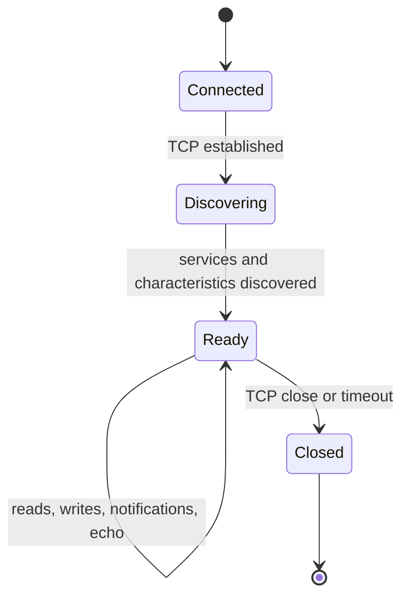

# WFTNP transport specification

Status: implementation specification for a local-network server that exposes a BLE-like GATT tree to the Rouvy client. This document defines the outer transport only. The GATT profiles carried inside it are defined in `wftnp-zwift-spec.md` and `wftnp-elite-spec.md`.

## 1. Scope

WFTNP (Wahoo Fitness TNP) carries BLE GATT operations over a TCP connection. A server advertises a service with mDNS, accepts one or more TCP connections, and answers requests that mirror BLE service discovery, characteristic discovery, reads, writes, and notifications.

The protocol is request/response for all client-originated operations, plus unsolicited notifications from the server. Every request carries a one-byte sequence number; the response must echo it. All multi-byte header fields are big-endian. UUIDs are carried as 16 raw bytes in canonical UUID text order.

The transport is independent of the payload semantics. A server may expose any mix of standard and vendor services.

## 2. Discovery

### 2.1 mDNS service

Advertise:

| Item | Value |
|---|---|
| Service type | `_wahoo-fitness-tnp._tcp` |
| Domain | `local.` |
| Instance name | Device name shown by the client |
| SRV target and port | Host name and TCP port of the server |
| A/AAAA record | Reachable address of the server |

The client resolves the SRV record and connects to the advertised host and port. The conventional default port is 36866, but the client must use the SRV port.

### 2.2 TXT records

The client reads these keys:

| Key | Required | Value |
|---|---|---|
| `serial-number` | Recommended | Device serial number as text |
| `mac-address` | Recommended | Interface MAC address as text |
| `ble-service-uuids` | Required for profile selection | Comma-separated list of service UUIDs |
| `manufacturer-data` | Profile-dependent | Hex-encoded manufacturer-specific bytes |

`ble-service-uuids` accepts two token forms:

- A full 128-bit UUID in canonical text form, for example `347B0001-7635-408B-8918-8FF3949CE592`.
- A 16-bit UUID written as `0xNNNN`, for example `0x1826`. The server expands it to `0000NNNN-0000-1000-8000-00805F9B34FB`.

Tokens are separated by commas with no spaces. Other token forms are ignored.

`manufacturer-data` is an even-length hexadecimal string with two characters per byte, for example `4A090B`. The client does not accept a `0x` prefix and does not accept spaces.

Example TXT set for an Elite Square profile:

```text
serial-number=SQ-0001
mac-address=02:00:00:00:00:01
ble-service-uuids=347B0001-7635-408B-8918-8FF3949CE592
```

Example TXT set for a Zwift controller profile:

```text
serial-number=ZC-0001
mac-address=02:00:00:00:00:02
ble-service-uuids=00000001-19CA-4651-86E5-FA29DCDD09D1
manufacturer-data=4A090B
```

## 3. TCP behavior

The server listens on the advertised port and accepts a TCP connection from the client.

Disable Nagle's algorithm (`TCP_NODELAY`) to keep notification latency low, and enable TCP keepalive so a dead peer is detected. Support a new connection after the previous one closes, because the client reconnects automatically after a link loss. The server may support one active client at a time; if a second client connects, it can either accept it independently or close the older connection. It must not assume that one TCP segment contains exactly one frame, nor that one frame fits in one segment.

## 4. Frame format

Every frame starts with a fixed 6-byte header followed by an optional body.

| Offset | Size | Field | Description |
|---:|---:|---|---|
| 0 | 1 | Version | Protocol version. Current value is `0x01`. |
| 1 | 1 | Type | Message type, see Section 5. |
| 2 | 1 | Sequence | Request identifier. The response echoes it. |
| 3 | 1 | Response code | `0x00` in requests. Status in responses. |
| 4 | 2 | Body length | Unsigned 16-bit big-endian length of the body. |
| 6 | N | Body | Type-specific payload. |

The maximum frame length is 4096 bytes, so the maximum body is 4090 bytes. A frame with a body length that exceeds the remaining bytes is incomplete and must wait for more data. A frame whose total length exceeds 4096 is invalid.

### 4.1 UUID encoding

A UUID is 16 bytes in canonical text order. Hyphens are not transmitted. For example:

```text
UUID text: 00001826-0000-1000-8000-00805F9B34FB
Wire:      00 00 18 26 00 00 10 00 80 00 00 80 5F 9B 34 FB
```

This is not the little-endian byte order used by some BLE APIs. Do not reverse the first three fields on the wire.

## 5. Message types

`C→S` means client to server, and `S→C` means server to client.

| Value | Name | Direction | Body |
|---:|---|---|---|
| `0x01` | Discover Services | C→S | Empty |
| `0x02` | Discover Characteristics | C→S | Service UUID |
| `0x03` | Read Characteristic | C→S | one characteristic UUID |
| `0x04` | Write Characteristic | C→S | a characteristic UUID followed by the value |
| `0x05` | Enable Characteristic Notifications | C→S | one characteristic UUID and an enable byte |
| `0x06` | Characteristic Notification | S→C | a characteristic UUID followed by the value |
| `0x07` | Echo | C→S | Empty |

Responses use the same type value as the request.

## 6. Response codes

| Value | Name | Meaning |
|---:|---|---|
| `0x00` | Success | Operation completed |
| `0x01` | Unknown message type | Type is not supported |
| `0x02` | Unexpected error | Generic server failure |
| `0x03` | Service not found | no service with that UUID is exposed |
| `0x04` | Characteristic not found | that UUID does not identify a characteristic on the service |
| `0x05` | Unsupported operation | Property does not allow the operation |
| `0x06` | Write failed | Write was rejected or failed |
| `0x07` | Unknown protocol version | Version byte is not supported |

A response to a failed request carries the same sequence number and the same type as the request. The body may be empty or may repeat the UUID, depending on the operation; the client does not require additional detail.

## 7. Operation layouts

### 7.1 Discover Services

Request:

```text
Version=01  Type=01  Seq=NN  Code=00  Length=0000
```

Response body: a sequence of 16-byte UUIDs.

```text
Service UUID #1 (16 bytes)
Service UUID #2 (16 bytes)
...
```

Example response with one service:

```text
01 01 00 00 00 10
34 7B 00 01 76 35 40 8B 89 18 8F F3 94 9C E5 92
```

The body length must be a multiple of 16. A zero-length body means the server exposes no services.

### 7.2 Discover Characteristics

Request body: the 16-byte service UUID.

Response body:

```text
Service UUID (16 bytes)
Characteristic record #1: UUID (16 bytes) + Properties (1 byte)
Characteristic record #2: UUID (16 bytes) + Properties (1 byte)
...
```

Property bits:

| Bit | Meaning |
|---:|---|
| `0x01` | Read |
| `0x02` | Write |
| `0x04` | Notify |

Other bits are ignored. A characteristic that supports read and notify uses `0x05`.

Example response for one characteristic:

```text
01 02 01 00 00 21
34 7B 00 01 76 35 40 8B 89 18 8F F3 94 9C E5 92
34 7B 00 43 76 35 40 8B 89 18 8F F3 94 9C E5 92
05
```

If the service has no characteristics, the response body is the 16-byte service UUID and the length is `0x0010`.

### 7.3 Read Characteristic

Request body: the 16-byte characteristic UUID.

Response body:

```text
Characteristic UUID (16 bytes)
Value (N bytes)
```

The value may be empty. The response body length is `16 + N`.

Example read response for a 6-byte value:

```text
01 03 02 00 00 16
34 7B 00 43 76 35 40 8B 89 18 8F F3 94 9C E5 92
00 01 57 00 00 00
```

### 7.4 Write Characteristic

Request body:

```text
Characteristic UUID (16 bytes)
Value (N bytes)
```

Response body:

```text
Characteristic UUID (16 bytes)
```

The response confirms that the write was accepted. A server that rejects the value responds with code `0x06`.

Example write of an 8-byte value:

```text
01 04 04 00 00 18
00 00 00 03 19 CA 46 51 86 E5 FA 29 DC DD 09 D1
52 69 64 65 4F 6E 02 01
```

The response is `01 04 04 00 00 10` followed by the characteristic UUID.

### 7.5 Enable Characteristic Notifications

Request body:

```text
Characteristic UUID (16 bytes)
Enable (1 byte): 01 = enable, 00 = disable
```

Response body:

```text
Characteristic UUID (16 bytes)
```

After a successful enable, the server may send notifications for that characteristic. After a disable, it must stop sending them.

Example request:

```text
01 05 03 00 00 11
00 00 00 02 19 CA 46 51 86 E5 FA 29 DC DD 09 D1
01
```

Response: `01 05 03 00 00 10` followed by the characteristic UUID.

### 7.6 Characteristic Notification

Body:

```text
Characteristic UUID (16 bytes)
Value (N bytes)
```

The sequence number is not used to match a request. Use any value, including `0x00`. The response code is `0x00`.

Notifications may be sent at any time after the corresponding enable. They may interleave with responses. The client parses frames by the length field, so back-to-back frames in one TCP segment are valid.

Example notification carrying a one-byte value:

```text
01 06 00 00 00 11
00 00 00 02 19 CA 46 51 86 E5 FA 29 DC DD 09 D1
23
```

### 7.7 Echo

Request body: empty.

Response body: empty.

The client sends an Echo request after a period of read inactivity to confirm that the connection is alive. The server must answer with the same sequence number, type `0x07`, and response code `0x00`.

Example:

```text
Request:  01 07 2A 00 00 00
Response: 01 07 2A 00 00 00
```

Failure to answer within the client's response timeout causes the client to treat the connection as dead and reconnect.

## 8. Sequencing and concurrency

The client assigns sequence numbers from a one-byte counter. It may wrap from `0xFF` to `0x00`. It normally keeps one request outstanding at a time, but the server should still match responses by sequence number rather than assuming strict order.

The server echoes the request sequence number in the response, keeps the response type equal to the request type, and never reuses a sequence number for a different outstanding request. It answers within the client response timeout, which is 8 seconds; a practical server answers in milliseconds.

Notifications do not consume sequence numbers.

## 9. Connection state machine

A typical client session proceeds as follows:



Sequence of operations:

1. The client connects to the SRV host and port.
2. The client sends Discover Services.
3. The client selects the services it understands and sends Discover Characteristics for each.
4. The client reads initial characteristic values where required.
5. The client enables notifications on the characteristics it wants.
6. The client writes commands and receives responses.
7. The server sends notifications as values change.
8. Either side may close the connection. The client reconnects if the device remains advertised.

## 10. Error handling

| Condition | Response |
|---|---|
| Unknown service | `0x03` |
| Unknown characteristic | `0x04` |
| Read without the read property | `0x05` |
| Write without the write property | `0x05` |
| Enable without the notify property | `0x05` |
| Malformed body | `0x02` |
| Version other than `0x01` | `0x07` |
| Frame above 4096 bytes | protocol error; close the connection if the stream cannot be resynchronized |

The server should log and ignore a frame with an unknown type, then answer with code `0x01` when the sequence number and body are still parseable.

## 11. Implementation checklist

| Requirement | Detail |
|---|---|
| Discovery | publish `_wahoo-fitness-tnp._tcp` in `local.` with SRV, A/AAAA, and TXT records |
| TCP listener | accept connections on the SRV port |
| Header | parse and emit the 6-byte big-endian header |
| UUIDs | encode and decode in canonical byte order |
| Service discovery | implement Discover Services and Discover Characteristics |
| Operations | implement Read, Write, and Enable Notifications |
| Notifications | emit only after enable |
| Echo | answer Echo requests |
| Response matching | match by sequence number and type |
| Frame limit | enforce 4096 bytes |
| Reconnect | recover cleanly when the client reconnects |
